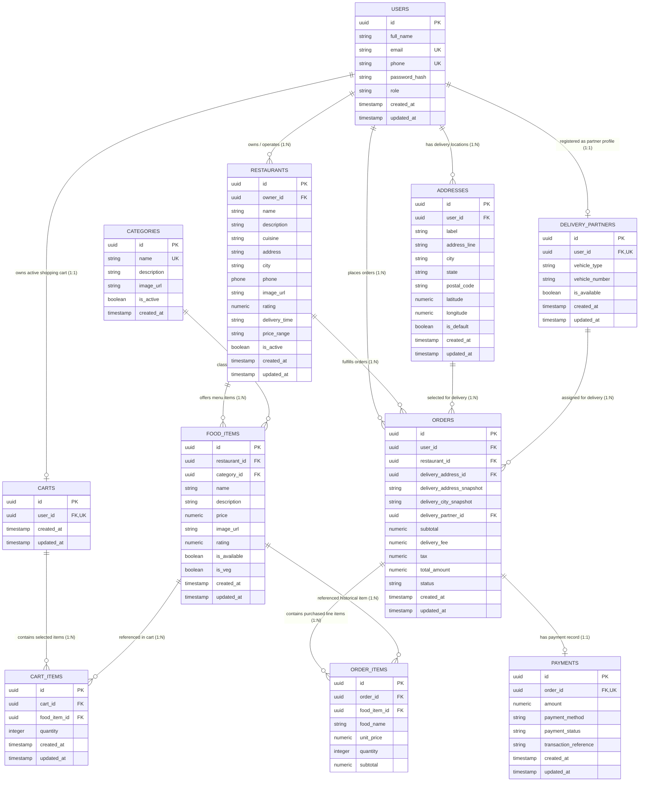

# FoodGo — Food Ordering & Delivery Platform
## Capstone Project Technical Specification: Problem Statement & ER Diagram

---

## 1. Project Overview & Executive Summary

**Project Name:** FoodGo — Multi-Role Food Ordering & Delivery Platform  
**Domain:** E-Commerce / On-Demand Service Aggregator  
**Tech Stack:** React.js (Frontend) + Java 17 Spring Boot 3.x (Backend REST API) + PostgreSQL / Supabase (Database)

**FoodGo** is a full-stack, enterprise-ready food ordering and delivery web application designed to bridge the gap between customers, restaurant owners, delivery partners, and platform administrators. The platform handles real-time menu management, shopping cart operations, transactional order placement with snapshot pricing, payment state management, and delivery partner dispatching.

---

## 2. Background & Problem Statement

### 2.1 Background & Context
The modern quick-service restaurant (QSR) and food delivery ecosystem demands seamless coordination among four independent actors: Customers, Restaurant Owners, Delivery Partners, and Platform Administrators. Traditional offline ordering or basic e-commerce applications suffer from several structural vulnerabilities:
1. **Historical Order Corruption:** Changing food prices or deleting menu items historically distorts past invoices and financial audit logs if orders directly reference mutable menu tables without data snapshotting.
2. **State Desynchronization:** Inability to handle concurrent state transitions (e.g., an order moving from `PENDING` $\rightarrow$ `CONFIRMED` $\rightarrow$ `PREPARING` $\rightarrow$ `OUT_FOR_DELIVERY` $\rightarrow$ `DELIVERED`).
3. **Data Integrity Hazards:** Cascading deletions causing orphaned records or accidental loss of user order history when restaurant profiles or delivery partner accounts are deleted.
4. **Lack of Role Isolation:** Absence of strict role-based data access control (RBAC) leading to security and unauthorized mutation risks across user types.

### 2.2 Formal Problem Statement
> *"Design, develop, and document a multi-tier, normalized, and secure Food Ordering & Delivery Web Platform (**FoodGo**) that provides real-time food discovery, robust shopping cart session state management, atomic order placement with historical price/address snapshotting, payment tracking, role-based user management, and automated database constraint enforcement using a PostgreSQL backend."*

---

## 3. Project Scope & Objectives

### 3.1 Primary Objectives
- **Data Normalization & Integrity:** Implement a relational database schema normalized up to 3rd Normal Form (3NF) containing 11 entities with strict referential integrity (`FOREIGN KEY`, `ON DELETE CASCADE / SET NULL / RESTRICT`, `CHECK` constraints).
- **Snapshot Pattern Enforcement:** Ensure invoice and address data immutability by snapshotting delivery address text and unit item prices at the moment an order is placed.
- **Role-Based Workflows:** Support 4 distinct user roles (`CUSTOMER`, `RESTAURANT`, `DELIVERY_PARTNER`, `ADMIN`) with isolated privileges and custom operational dashboards.
- **RESTful Backend Architecture:** Build a layered Java Spring Boot backend (`Controller` $\rightarrow$ `Service` $\rightarrow$ `Repository` $\rightarrow$ `Model/DTO`).

### 3.2 System Boundaries & Scope

| Feature Area | In-Scope | Out-of-Scope (Future Enhancements) |
| :--- | :--- | :--- |
| **Authentication & Users** | Multi-role registration, login, profile management, shipping address directory | OAuth2 social login, biometrics |
| **Catalog & Search** | Restaurant directory, categorised menus, veg/non-veg flags, price ranges, search/filter | AI-powered menu recommendations |
| **Cart & Checkout** | User cart persistence, item quantity updates, delivery fee calculation, tax calculations | Multi-restaurant mixed carts in a single order |
| **Orders & Invoicing** | Order state machine, item price snapshotting, delivery address snapshotting | Real-time GPS driver tracking on live map |
| **Payments** | Payment status tracking (`PENDING`, `SUCCESS`, `FAILED`), COD & Mock Online modes | Real bank gateway API integrations (Stripe/Razorpay) |

---

## 4. User Roles & Actor Analysis

1. **CUSTOMER**: Can create multiple delivery addresses, manage an active cart, place orders, choose payment options, and track order progress.
2. **RESTAURANT OWNER**: Owns restaurant entities, adds/edits food items under standardized categories, toggles item availability, and updates order states (`CONFIRMED`, `PREPARING`).
3. **DELIVERY PARTNER**: Links to a user profile, specifies vehicle details (`vehicle_type`, `vehicle_number`), toggles availability, and receives assigned orders (`OUT_FOR_DELIVERY`, `DELIVERED`).
4. **PLATFORM ADMIN**: Oversees categories, monitors users, manages platform parameters, and enforces platform compliance.

---

## 5. Entity-Relationship (ER) Diagram

### 5.1 Mermaid ER Diagram (Conceptual & Logical Model)

---

## 6. Entity Relationship Matrix & Cardinalities

| Source Entity | Target Entity | Relationship Type | Cardinality | FK Location | Delete Rule & Justification |
| :--- | :--- | :--- | :--- | :--- | :--- |
| `USERS` | `RESTAURANTS` | One-to-Many | `1 : 0..N` | `restaurants.owner_id` | `ON DELETE SET NULL`: Deleting owner account retains restaurant listing for business operational continuity. |
| `USERS` | `ADDRESSES` | One-to-Many | `1 : 0..N` | `addresses.user_id` | `ON DELETE CASCADE`: Deleting user removes their saved address book. |
| `USERS` | `CARTS` | One-to-One | `1 : 0..1` | `carts.user_id` (UNIQUE) | `ON DELETE CASCADE`: Deleting user destroys active cart session. |
| `CARTS` | `CART_ITEMS` | One-to-Many | `1 : 0..N` | `cart_items.cart_id` | `ON DELETE CASCADE`: Clearing cart drops all line items. |
| `FOOD_ITEMS` | `CART_ITEMS` | One-to-Many | `1 : 0..N` | `cart_items.food_item_id` | `ON DELETE CASCADE`: Removing item from menu auto-evicts it from carts. |
| `CATEGORIES` | `FOOD_ITEMS` | One-to-Many | `1 : 0..N` | `food_items.category_id` | `ON DELETE RESTRICT`: Cannot delete a category while active food items reference it. |
| `RESTAURANTS` | `FOOD_ITEMS` | One-to-Many | `1 : 0..N` | `food_items.restaurant_id` | `ON DELETE CASCADE`: Deleting restaurant deletes all menu items. |
| `USERS` | `DELIVERY_PARTNERS` | One-to-One | `1 : 0..1` | `delivery_partners.user_id` (UNIQUE) | `ON DELETE CASCADE`: Deleting user removes partner record. |
| `USERS` | `ORDERS` | One-to-Many | `1 : 0..N` | `orders.user_id` | `ON DELETE RESTRICT`: User accounts with order history cannot be hard deleted. |
| `RESTAURANTS` | `ORDERS` | One-to-Many | `1 : 0..N` | `orders.restaurant_id` | `ON DELETE RESTRICT`: Restaurants with past financial orders cannot be purged. |
| `ADDRESSES` | `ORDERS` | One-to-Many | `1 : 0..N` | `orders.delivery_address_id` | `ON DELETE SET NULL`: Address deletion preserves order record via address snapshot text. |
| `DELIVERY_PARTNERS` | `ORDERS` | One-to-Many | `1 : 0..N` | `orders.delivery_partner_id` | `ON DELETE SET NULL`: Unbinds delivery partner if driver account is purged. |
| `ORDERS` | `ORDER_ITEMS` | One-to-Many | `1 : 1..N` | `order_items.order_id` | `ON DELETE CASCADE`: Purging an order purges its invoice line items. |
| `FOOD_ITEMS` | `ORDER_ITEMS` | One-to-Many | `1 : 0..N` | `order_items.food_item_id` | `ON DELETE SET NULL`: Preserves historical line item via `food_name` & `unit_price` snapshots. |
| `ORDERS` | `PAYMENTS` | One-to-One | `1 : 1` | `payments.order_id` (UNIQUE) | `ON DELETE CASCADE`: Deleting order removes payment transaction record. |

---

## 7. Data Dictionary & Detailed Database Schema

### 7.1 `users` Table
Stores authentication credentials, contact details, and system roles.
- **Primary Key:** `id` (UUID)
- **Indexes:** `idx_users_email` ON (`email`)

| Column Name | Data Type | Constraints | Description |
| :--- | :--- | :--- | :--- |
| `id` | `UUID` | `PRIMARY KEY`, Default `gen_random_uuid()` | Unique user identifier |
| `full_name` | `VARCHAR(100)` | `NOT NULL` | Full legal/display name |
| `email` | `VARCHAR(150)` | `NOT NULL`, `UNIQUE` | Email address (login username) |
| `phone` | `VARCHAR(20)` | `UNIQUE` | Primary contact number |
| `password_hash` | `VARCHAR(255)` | `NOT NULL` | Bcrypt/Argon2 encrypted password hash |
| `role` | `VARCHAR(20)` | `NOT NULL`, `CHECK (role IN ('CUSTOMER', 'ADMIN', 'RESTAURANT', 'DELIVERY_PARTNER'))` | Access control role |
| `created_at` | `TIMESTAMPTZ` | Default `CURRENT_TIMESTAMP` | Account registration timestamp |
| `updated_at` | `TIMESTAMPTZ` | Default `CURRENT_TIMESTAMP` | Last profile update timestamp |

---

### 7.2 `restaurants` Table
Stores restaurant profiles, cuisine categories, ratings, and operating flags.
- **Primary Key:** `id` (UUID)
- **Foreign Keys:** `owner_id` $\rightarrow$ `users(id)` (`ON DELETE SET NULL`)
- **Indexes:** `idx_restaurants_city` ON (`city`)

| Column Name | Data Type | Constraints | Description |
| :--- | :--- | :--- | :--- |
| `id` | `UUID` | `PRIMARY KEY`, Default `gen_random_uuid()` | Unique restaurant identifier |
| `owner_id` | `UUID` | `NULLABLE`, `REFERENCES users(id)` | User ID of restaurant owner |
| `name` | `VARCHAR(150)` | `NOT NULL` | Restaurant brand name |
| `description` | `TEXT` | `NULLABLE` | Overview/tagline |
| `cuisine` | `VARCHAR(100)` | `NOT NULL` | Primary cuisine type (e.g. Italian, Indian) |
| `address` | `TEXT` | `NOT NULL` | Physical store location |
| `city` | `VARCHAR(100)` | `NOT NULL` | City name for location filtering |
| `phone` | `VARCHAR(20)` | `NULLABLE` | Store direct contact number |
| `image_url` | `TEXT` | `NULLABLE` | Banner thumbnail image URL |
| `rating` | `NUMERIC(2,1)` | Default `0.0`, `CHECK (rating >= 0.0 AND rating <= 5.0)` | Average aggregate review rating |
| `delivery_time` | `VARCHAR(50)` | Default `'25–30 min'` | Estimated fulfillment window |
| `price_range` | `VARCHAR(10)` | Default `'₹₹'` | Affordability indicator (`₹`, `₹₹`, `₹₹₹`) |
| `is_active` | `BOOLEAN` | Default `true` | Operational status toggle |
| `created_at` | `TIMESTAMPTZ` | Default `CURRENT_TIMESTAMP` | Creation timestamp |
| `updated_at` | `TIMESTAMPTZ` | Default `CURRENT_TIMESTAMP` | Last update timestamp |

---

### 7.3 `categories` Table
Standardized master taxonomy for categorizing menu items across restaurants.
- **Primary Key:** `id` (UUID)

| Column Name | Data Type | Constraints | Description |
| :--- | :--- | :--- | :--- |
| `id` | `UUID` | `PRIMARY KEY`, Default `gen_random_uuid()` | Unique category identifier |
| `name` | `VARCHAR(100)` | `NOT NULL`, `UNIQUE` | Category name (e.g., Burgers, Pizza, Desserts) |
| `description` | `TEXT` | `NULLABLE` | Category details |
| `image_url` | `TEXT` | `NULLABLE` | Category icon / hero image URL |
| `is_active` | `BOOLEAN` | Default `true` | Visibility toggle |
| `created_at` | `TIMESTAMPTZ` | Default `CURRENT_TIMESTAMP` | Creation timestamp |

---

### 7.4 `food_items` Table
Individual food items listed under specific restaurants and categories.
- **Primary Key:** `id` (UUID)
- **Foreign Keys:**  
  - `restaurant_id` $\rightarrow$ `restaurants(id)` (`ON DELETE CASCADE`)
  - `category_id` $\rightarrow$ `categories(id)` (`ON DELETE RESTRICT`)
- **Indexes:** `idx_food_items_restaurant` ON (`restaurant_id`), `idx_food_items_category` ON (`category_id`)

| Column Name | Data Type | Constraints | Description |
| :--- | :--- | :--- | :--- |
| `id` | `UUID` | `PRIMARY KEY`, Default `gen_random_uuid()` | Unique food item identifier |
| `restaurant_id` | `UUID` | `NOT NULL`, `REFERENCES restaurants(id)` | Parent restaurant |
| `category_id` | `UUID` | `NOT NULL`, `REFERENCES categories(id)` | Master category classification |
| `name` | `VARCHAR(150)` | `NOT NULL` | Dish name |
| `description` | `TEXT` | `NULLABLE` | Ingredients & dish description |
| `price` | `NUMERIC(10,2)` | `NOT NULL`, `CHECK (price >= 0)` | Base selling price |
| `image_url` | `TEXT` | `NULLABLE` | Dish picture URL |
| `rating` | `NUMERIC(2,1)` | Default `0.0`, `CHECK (rating >= 0.0 AND rating <= 5.0)` | Item rating score |
| `is_available` | `BOOLEAN` | Default `true` | Real-time kitchen availability flag |
| `is_veg` | `BOOLEAN` | Default `true` | Dietary preference indicator (Veg vs Non-Veg) |
| `created_at` | `TIMESTAMPTZ` | Default `CURRENT_TIMESTAMP` | Creation timestamp |
| `updated_at` | `TIMESTAMPTZ` | Default `CURRENT_TIMESTAMP` | Last update timestamp |

---

### 7.5 `addresses` Table
User delivery address directory supporting geographical coordinates and default selections.
- **Primary Key:** `id` (UUID)
- **Foreign Keys:** `user_id` $\rightarrow$ `users(id)` (`ON DELETE CASCADE`)
- **Indexes:** `idx_addresses_user` ON (`user_id`)

| Column Name | Data Type | Constraints | Description |
| :--- | :--- | :--- | :--- |
| `id` | `UUID` | `PRIMARY KEY`, Default `gen_random_uuid()` | Unique address record ID |
| `user_id` | `UUID` | `NOT NULL`, `REFERENCES users(id)` | Owner user account |
| `label` | `VARCHAR(50)` | `NOT NULL`, Default `'Home'` | Address tag (e.g. Home, Work, Other) |
| `address_line` | `TEXT` | `NOT NULL` | Street, building, flat number details |
| `city` | `VARCHAR(100)` | `NOT NULL` | Destination city |
| `state` | `VARCHAR(100)` | `NULLABLE` | State / Province |
| `postal_code` | `VARCHAR(20)` | `NULLABLE` | ZIP / PIN code |
| `latitude` | `NUMERIC(10,7)` | `NULLABLE` | Geolocation latitude coordinate |
| `longitude` | `NUMERIC(10,7)` | `NULLABLE` | Geolocation longitude coordinate |
| `is_default` | `BOOLEAN` | Default `false` | Primary address selection flag |
| `created_at` | `TIMESTAMPTZ` | Default `CURRENT_TIMESTAMP` | Creation timestamp |
| `updated_at` | `TIMESTAMPTZ` | Default `CURRENT_TIMESTAMP` | Last update timestamp |

---

### 7.6 `carts` Table
Persistent user shopping cart container (1:1 with `users`).
- **Primary Key:** `id` (UUID)
- **Foreign Keys:** `user_id` $\rightarrow$ `users(id)` (`ON DELETE CASCADE`, `UNIQUE`)

| Column Name | Data Type | Constraints | Description |
| :--- | :--- | :--- | :--- |
| `id` | `UUID` | `PRIMARY KEY`, Default `gen_random_uuid()` | Unique cart ID |
| `user_id` | `UUID` | `NOT NULL`, `UNIQUE`, `REFERENCES users(id)` | Single owner customer account |
| `created_at` | `TIMESTAMPTZ` | Default `CURRENT_TIMESTAMP` | Cart initialization timestamp |
| `updated_at` | `TIMESTAMPTZ` | Default `CURRENT_TIMESTAMP` | Last modification timestamp |

---

### 7.7 `cart_items` Table
Junction entity representing items added to a customer's active cart.
- **Primary Key:** `id` (UUID)
- **Foreign Keys:**  
  - `cart_id` $\rightarrow$ `carts(id)` (`ON DELETE CASCADE`)
  - `food_item_id` $\rightarrow$ `food_items(id)` (`ON DELETE CASCADE`)
- **Composite Unique Constraint:** `UNIQUE (cart_id, food_item_id)`
- **Indexes:** `idx_cart_items_cart` ON (`cart_id`)

| Column Name | Data Type | Constraints | Description |
| :--- | :--- | :--- | :--- |
| `id` | `UUID` | `PRIMARY KEY`, Default `gen_random_uuid()` | Unique cart line item ID |
| `cart_id` | `UUID` | `NOT NULL`, `REFERENCES carts(id)` | Parent cart reference |
| `food_item_id` | `UUID` | `NOT NULL`, `REFERENCES food_items(id)` | Selected food item |
| `quantity` | `INTEGER` | `NOT NULL`, Default `1`, `CHECK (quantity > 0)` | Ordered quantity |
| `created_at` | `TIMESTAMPTZ` | Default `CURRENT_TIMESTAMP` | Added timestamp |
| `updated_at` | `TIMESTAMPTZ` | Default `CURRENT_TIMESTAMP` | Updated timestamp |

---

### 7.8 `delivery_partners` Table
Delivery fleet drivers associated with user accounts.
- **Primary Key:** `id` (UUID)
- **Foreign Keys:** `user_id` $\rightarrow$ `users(id)` (`ON DELETE CASCADE`, `UNIQUE`)

| Column Name | Data Type | Constraints | Description |
| :--- | :--- | :--- | :--- |
| `id` | `UUID` | `PRIMARY KEY`, Default `gen_random_uuid()` | Unique partner record ID |
| `user_id` | `UUID` | `NOT NULL`, `UNIQUE`, `REFERENCES users(id)` | Linked user account |
| `vehicle_type` | `VARCHAR(50)` | `NOT NULL` | Vehicle classification (e.g. Scooter, Bike, EV) |
| `vehicle_number` | `VARCHAR(50)` | `NULLABLE` | Registration license plate |
| `is_available` | `BOOLEAN` | Default `true` | Duty status toggle (On-duty / Off-duty) |
| `created_at` | `TIMESTAMPTZ` | Default `CURRENT_TIMESTAMP` | Registration timestamp |
| `updated_at` | `TIMESTAMPTZ` | Default `CURRENT_TIMESTAMP` | Last update timestamp |

---

### 7.9 `orders` Table
Central transactional record storing order lifecycle state, subtotal breakdowns, snapshot address text, and driver assignments.
- **Primary Key:** `id` (UUID)
- **Foreign Keys:**  
  - `user_id` $\rightarrow$ `users(id)` (`ON DELETE RESTRICT`)
  - `restaurant_id` $\rightarrow$ `restaurants(id)` (`ON DELETE RESTRICT`)
  - `delivery_address_id` $\rightarrow$ `addresses(id)` (`ON DELETE SET NULL`)
  - `delivery_partner_id` $\rightarrow$ `delivery_partners(id)` (`ON DELETE SET NULL`)
- **Indexes:** `idx_orders_user` ON (`user_id`), `idx_orders_restaurant` ON (`restaurant_id`), `idx_orders_status` ON (`status`)

| Column Name | Data Type | Constraints | Description |
| :--- | :--- | :--- | :--- |
| `id` | `UUID` | `PRIMARY KEY`, Default `gen_random_uuid()` | Unique order reference |
| `user_id` | `UUID` | `NOT NULL`, `REFERENCES users(id)` | Customer placing order |
| `restaurant_id` | `UUID` | `NOT NULL`, `REFERENCES restaurants(id)` | Target restaurant fulfilling order |
| `delivery_address_id` | `UUID` | `NULLABLE`, `REFERENCES addresses(id)` | Original reference address ID |
| `delivery_address_snapshot` | `TEXT` | `NOT NULL` | Immutable text snapshot of full street address |
| `delivery_city_snapshot` | `VARCHAR(100)` | `NOT NULL` | Immutable snapshot of city name |
| `delivery_partner_id` | `UUID` | `NULLABLE`, `REFERENCES delivery_partners(id)` | Assigned delivery driver |
| `subtotal` | `NUMERIC(10,2)` | `NOT NULL`, `CHECK (subtotal >= 0)` | Net sum of item prices |
| `delivery_fee` | `NUMERIC(10,2)` | `NOT NULL`, Default `40.00`, `CHECK (delivery_fee >= 0)` | Shipping charge |
| `tax` | `NUMERIC(10,2)` | `NOT NULL`, Default `0.00`, `CHECK (tax >= 0)` | Applicable taxes |
| `total_amount` | `NUMERIC(10,2)` | `NOT NULL`, `CHECK (total_amount >= 0)` | Gross order total (`subtotal + delivery_fee + tax`) |
| `status` | `VARCHAR(30)` | `NOT NULL`, Default `'PENDING'`, `CHECK (status IN ('PENDING', 'CONFIRMED', 'PREPARING', 'OUT_FOR_DELIVERY', 'DELIVERED', 'CANCELLED'))` | Order lifecycle state |
| `created_at` | `TIMESTAMPTZ` | Default `CURRENT_TIMESTAMP` | Placement timestamp |
| `updated_at` | `TIMESTAMPTZ` | Default `CURRENT_TIMESTAMP` | State change timestamp |

---

### 7.10 `order_items` Table
Purchased line items attached to a specific order with frozen historic prices and names.
- **Primary Key:** `id` (UUID)
- **Foreign Keys:**  
  - `order_id` $\rightarrow$ `orders(id)` (`ON DELETE CASCADE`)
  - `food_item_id` $\rightarrow$ `food_items(id)` (`ON DELETE SET NULL`)
- **Indexes:** `idx_order_items_order` ON (`order_id`)

| Column Name | Data Type | Constraints | Description |
| :--- | :--- | :--- | :--- |
| `id` | `UUID` | `PRIMARY KEY`, Default `gen_random_uuid()` | Unique order line item ID |
| `order_id` | `UUID` | `NOT NULL`, `REFERENCES orders(id)` | Parent order reference |
| `food_item_id` | `UUID` | `NULLABLE`, `REFERENCES food_items(id)` | Reference to original menu item |
| `food_name` | `VARCHAR(150)` | `NOT NULL` | Immutable text snapshot of dish name |
| `unit_price` | `NUMERIC(10,2)` | `NOT NULL`, `CHECK (unit_price >= 0)` | Immutable unit price at checkout time |
| `quantity` | `INTEGER` | `NOT NULL`, `CHECK (quantity > 0)` | Quantity purchased |
| `subtotal` | `NUMERIC(10,2)` | `NOT NULL`, `CHECK (subtotal >= 0)` | Line total (`unit_price * quantity`) |

---

### 7.11 `payments` Table
Financial transaction records linked 1:1 to completed or pending orders.
- **Primary Key:** `id` (UUID)
- **Foreign Keys:** `order_id` $\rightarrow$ `orders(id)` (`ON DELETE CASCADE`, `UNIQUE`)
- **Indexes:** `idx_payments_order` ON (`order_id`)

| Column Name | Data Type | Constraints | Description |
| :--- | :--- | :--- | :--- |
| `id` | `UUID` | `PRIMARY KEY`, Default `gen_random_uuid()` | Unique payment record ID |
| `order_id` | `UUID` | `NOT NULL`, `UNIQUE`, `REFERENCES orders(id)` | Associated order reference |
| `amount` | `NUMERIC(10,2)` | `NOT NULL`, `CHECK (amount >= 0)` | Transaction amount charged |
| `payment_method` | `VARCHAR(20)` | `NOT NULL`, Default `'COD'`, `CHECK (payment_method IN ('MOCK', 'COD', 'ONLINE'))` | Payment mode chosen |
| `payment_status` | `VARCHAR(20)` | `NOT NULL`, Default `'PENDING'`, `CHECK (payment_status IN ('PENDING', 'SUCCESS', 'FAILED', 'REFUNDED'))` | Settlement state |
| `transaction_reference` | `VARCHAR(100)` | `NULLABLE` | Gateway transaction ref or bank reference code |
| `created_at` | `TIMESTAMPTZ` | Default `CURRENT_TIMESTAMP` | Transaction initiation time |
| `updated_at` | `TIMESTAMPTZ` | Default `CURRENT_TIMESTAMP` | Settlement update time |

---

## 8. Critical Architectural Integrity Rules & Design Patterns

### 8.1 Price and Address Snapshot Pattern (Immutability Pattern)
In an e-commerce platform, prices change frequently and customers update/delete addresses. If orders directly relied on dynamic FK links:
- Changing a pizza price from ₹300 to ₹350 would retroactively inflate past receipts from yesterday.
- Deleting an address from the user's profile would break historic order invoices or throw foreign key deletion errors.

**FoodGo Solution:**
- `orders` table maintains `delivery_address_snapshot` (`TEXT`) and `delivery_city_snapshot` (`VARCHAR`).
- `order_items` table maintains `food_name` (`VARCHAR`) and `unit_price` (`NUMERIC(10,2)`).
- When an order is created, the system captures snapshot values. If the parent `addresses` or `food_items` record is deleted or updated later, historical order records remain completely untouched and valid.

### 8.2 Database Normalization & 3NF Compliance
1. **First Normal Form (1NF):** All table columns hold atomic values (no comma-separated lists of items or addresses). Primary keys uniquely identify every row.
2. **Second Normal Form (2NF):** All non-key attributes are fully functionally dependent on the primary key. Composite junction entities (`cart_items`) use strict candidate keys `(cart_id, food_item_id)`.
3. **Third Normal Form (3NF):** No transitive dependencies exist. Attributes like `unit_price` and `food_name` in `order_items` are intentional denormalizations required by the **Temporal Snapshot Pattern** to prevent audit drift.

---

## 9. Summary Table of Database Entities & Structural Keys

| Entity Name | Primary Key | Foreign Key (FK) References | Unique Key Constraints |
| :--- | :--- | :--- | :--- |
| `users` | `id` | None | `email`, `phone` |
| `restaurants` | `id` | `owner_id` $\rightarrow$ `users.id` | None |
| `categories` | `id` | None | `name` |
| `food_items` | `id` | `restaurant_id` $\rightarrow$ `restaurants.id`, `category_id` $\rightarrow$ `categories.id` | None |
| `addresses` | `id` | `user_id` $\rightarrow$ `users.id` | None |
| `carts` | `id` | `user_id` $\rightarrow$ `users.id` | `user_id` |
| `cart_items` | `id` | `cart_id` $\rightarrow$ `carts.id`, `food_item_id` $\rightarrow$ `food_items.id` | `(cart_id, food_item_id)` |
| `delivery_partners` | `id` | `user_id` $\rightarrow$ `users.id` | `user_id` |
| `orders` | `id` | `user_id` $\rightarrow$ `users.id`, `restaurant_id` $\rightarrow$ `restaurants.id`, `delivery_address_id` $\rightarrow$ `addresses.id`, `delivery_partner_id` $\rightarrow$ `delivery_partners.id` | None |
| `order_items` | `id` | `order_id` $\rightarrow$ `orders.id`, `food_item_id` $\rightarrow$ `food_items.id` | None |
| `payments` | `id` | `order_id` $\rightarrow$ `orders.id` | `order_id` |
